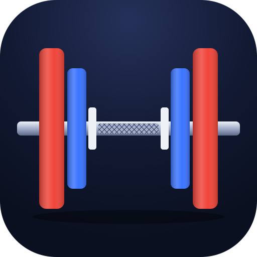
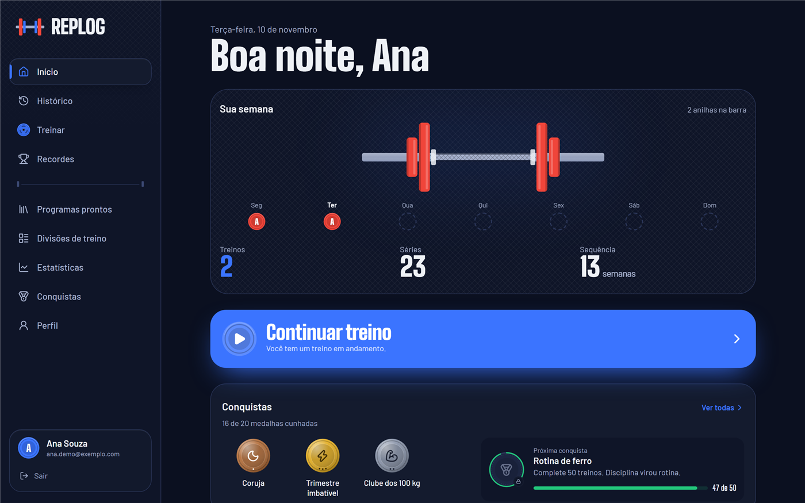
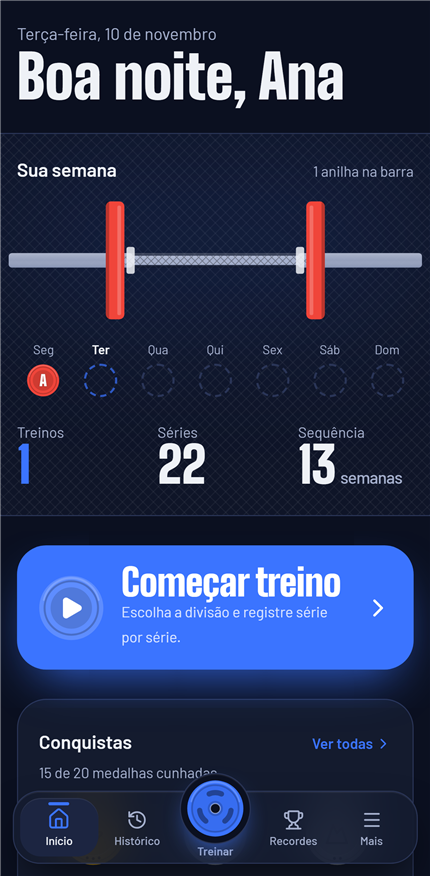
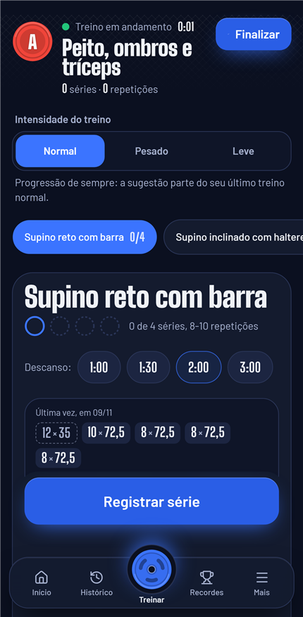
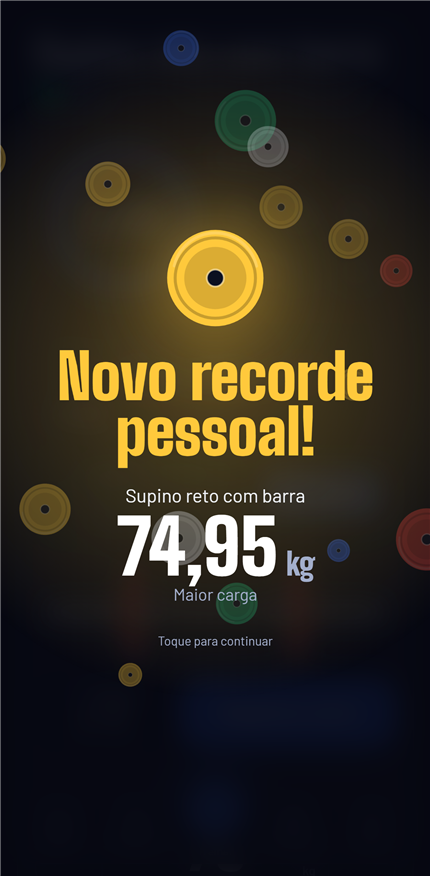
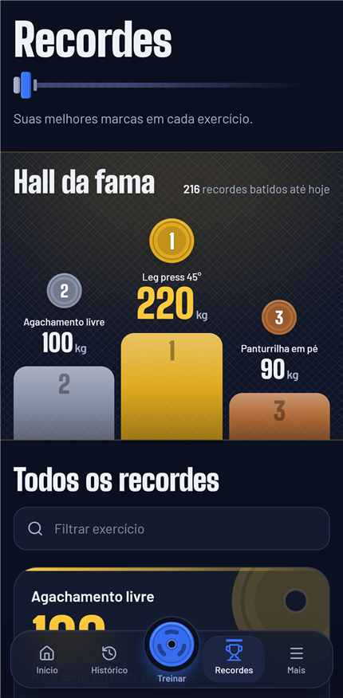
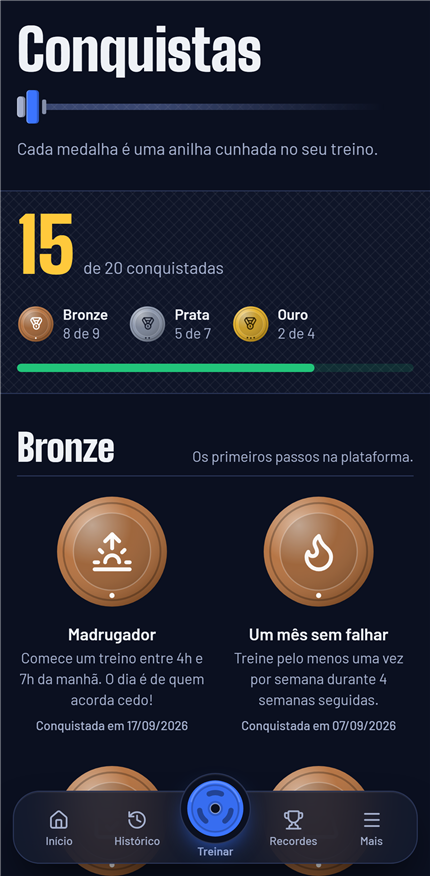
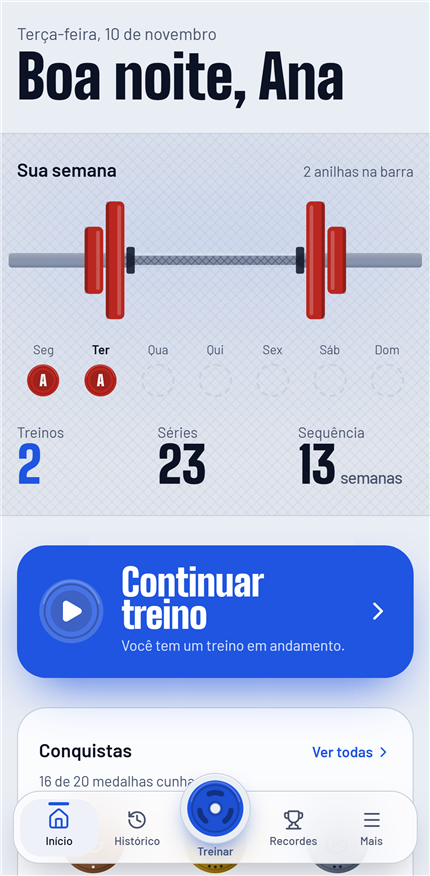
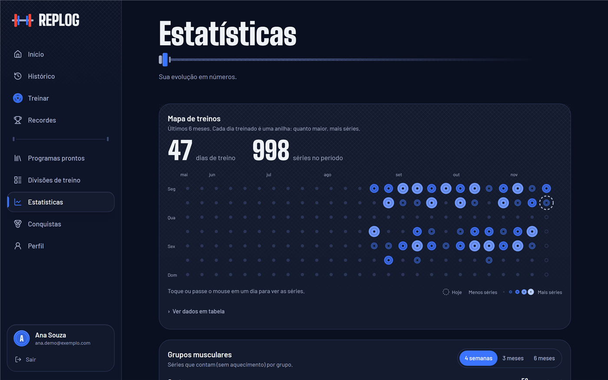
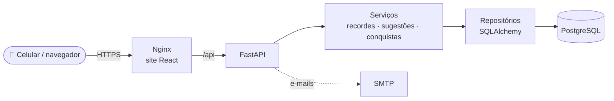

<div align="center">



# REPLOG

### Registre cada repetição. Supere cada recorde.

Diário de treino de musculação feito para usar no celular, no meio da academia.<br/>
Cada série fica salva, os recordes aparecem sozinhos e a evolução vira gráfico.


[Telas](#-telas) •
[Funcionalidades](#-funcionalidades) •
[Como funciona](#-como-funciona) •
[Tecnologias](#-tecnologias) •
[Rodar no seu PC](#-rodando-no-seu-computador) •
[Testes](#-testes-e-qualidade)

</div>

<br/>

<p align="center">
  
</p>

## 📱 Telas

<table>
  <tr>
    <td align="center"><br/><sub><b>Início</b><br/>a semana desenhada como uma barra com anilhas</sub></td>
    <td align="center"><br/><sub><b>Treino</b><br/>série a série, com o que você fez da última vez</sub></td>
    <td align="center"><br/><sub><b>Novo recorde</b><br/>comemorado na hora</sub></td>
    <td align="center"><br/><sub><b>Recordes</b><br/>maior carga, repetições e 1RM</sub></td>
  </tr>
  <tr>
    <td align="center"><br/><sub><b>Conquistas</b><br/>medalhas de bronze, prata e ouro</sub></td>
    <td align="center"><br/><sub><b>Tema claro</b><br/>segue o tema do aparelho</sub></td>
    <td align="center" colspan="2"><br/><sub><b>Estatísticas</b><br/>mapa de treinos e séries por semana</sub></td>
  </tr>
</table>

## ✨ Funcionalidades

<details open>
<summary><b>🏋️ Treino</b></summary>

- Divisões de treino (A a E), programas prontos ou treino livre
- Registro série a série com botões − e +, já preenchido com a carga sugerida
- **Sugestão de carga por dupla progressão:** bateu o topo das repetições em todas as séries, a carga sobe
- **Intensidade do treino:** normal, pesado (poucas repetições, muita carga) ou leve (semana de descanso, cerca de 60% da carga). O app compara cada treino com outro do mesmo tipo, então uma semana leve não "estraga" a sua progressão.
- Séries de aquecimento marcadas à parte, sem contar para recordes nem para as séries
- Cronômetro de descanso com aviso, e a tela não apaga durante o treino
</details>

<details>
<summary><b>🏆 Recordes e conquistas</b></summary>

- Recordes detectados sozinhos: **maior carga**, **mais repetições** e **1RM estimado** (fórmula de Epley)
- Se você corrige ou apaga uma série, os recordes são recalculados e nunca ficam errados
- 20 medalhas de constância, recordes e séries acumuladas
</details>

<details>
<summary><b>📊 Histórico e estatísticas</b></summary>

- Calendário, lista por semana e detalhe de cada treino
- Comparação com o treino anterior da mesma divisão
- Mapa dos últimos 6 meses, em que cada dia de treino vira uma anilha
- Séries por semana e por mês, séries por grupo muscular e evolução de cada exercício
- O trabalho é medido em **séries, repetições e maior carga**, sem somar "kg levantados"
</details>

<details>
<summary><b>🔐 Conta, privacidade e administração</b></summary>

- Cadastro com confirmação por e-mail, login, recuperação e troca de senha
- Encerrar as sessões abertas em outros aparelhos
- **LGPD:** exportar todos os seus dados e excluir a conta
- Painel de administração com números gerais, contas e catálogo de exercícios. Os treinos de cada pessoa continuam privados.
- Fuso horário detectado pelo aparelho e app instalável no celular (PWA)
</details>

## 🧠 Como funciona



O backend é organizado em camadas: **rotas** recebem a requisição, **serviços** guardam as regras do treino e **repositórios** falam com o banco. O frontend usa TanStack Query para guardar os dados em cache e atualizar só o que mudou depois de cada série.

```
backend/    API: core, db, models, schemas, repositories, services, routes, middleware
            alembic/ (migrações do banco) e tests/
frontend/   Interface: api, components, features, lib, routes, e testes e2e/
deploy/     Configuração do Caddy (HTTPS automático em produção)
scripts/    Backup do banco e configuração do servidor
```

## 🛠 Tecnologias

| Camada | Ferramentas |
|---|---|
| **Backend** | Python 3.12, FastAPI, Pydantic 2, SQLAlchemy 2, Alembic, Argon2id |
| **Frontend** | React 19, TypeScript, Vite, Tailwind CSS 4, Motion, TanStack Query, Recharts |
| **Banco** | SQLite no desenvolvimento, PostgreSQL em produção |
| **Testes** | Pytest, Vitest, Testing Library, Playwright |
| **Qualidade** | Ruff, Mypy (modo estrito), Bandit, pip-audit, ESLint, npm audit |
| **Infra** | Docker, Nginx, Caddy, Mailpit |

## 🚀 Rodando no seu computador

Pré-requisitos: **Python 3.12+**, **Node 20+** e **Docker Desktop** (para a caixa de e-mails de teste).

<details open>
<summary><b>1. Configuração (só na primeira vez)</b></summary>

```powershell
copy .env.example .env
python -c "import secrets; print(secrets.token_urlsafe(48))"
```

Cole o valor gerado em `REPLOG_SECRET_KEY`, dentro do `.env`.
</details>

<details>
<summary><b>2. Caixa de e-mails de teste (Mailpit)</b></summary>

```powershell
docker compose up -d
```

Os e-mails do app chegam em **http://localhost:8025**. Nada é enviado de verdade.
</details>

<details>
<summary><b>3. Backend (API)</b></summary>

```powershell
cd backend
python -m venv .venv
.\.venv\Scripts\pip install -e ".[dev]"
.\.venv\Scripts\alembic upgrade head
.\.venv\Scripts\python -m app.seeds
.\.venv\Scripts\uvicorn app.main:app --reload
```

A documentação interativa da API fica em http://localhost:8000/api/docs.
</details>

<details>
<summary><b>4. Frontend (outro terminal)</b></summary>

```powershell
cd frontend
npm install
npm run dev
```

Abra **http://localhost:5173**, crie sua conta e confirme pelo e-mail que aparece no Mailpit.

Para abrir no celular na mesma rede Wi-Fi, rode `npm run dev -- --host` e use o endereço "Network" que aparecer.
</details>

<details>
<summary><b>Tornar uma conta administradora</b></summary>

```powershell
cd backend
.\.venv\Scripts\python -m app.cli promover seu-email@exemplo.com
```
</details>

<details>
<summary><b>Publicar com Docker (produção)</b></summary>

```bash
cp .env.production.example .env.production
docker compose -f docker-compose.prod.yml --env-file .env.production up -d --build
```

O Caddy emite o certificado HTTPS sozinho para o domínio de `REPLOG_DOMAIN`. Em um servidor Linux novo, `scripts/configurar-producao.sh` faz a configuração guiada.
</details>

## ✅ Testes e qualidade

| Suíte | Comando | O que cobre |
|---|---|---|
| Backend | `pytest` | ~350 testes: regras de treino, recordes, sugestões, segurança e API |
| Frontend | `npm test` | Componentes e telas com Vitest + Testing Library |
| Ponta a ponta | `npm run e2e` | Cadastro → e-mail → treino → recorde, no navegador de verdade (Playwright) |
| Estilo e tipos | `ruff check .` · `mypy app` · `npm run lint` · `npm run typecheck` | |
| Segurança | `bandit -r app` · `pip-audit` · `npm audit` | |

<div align="center">
<br/>
<sub>Feito por <b>Wissam Saleh</b></sub>
</div>
